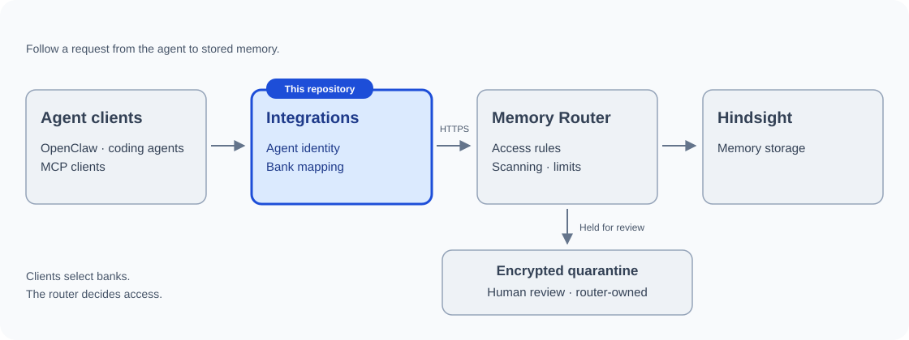

# Integrations for Hindsight Memory Router

[](https://github.com/mickey-kras/hindsight-memory-router-integrations/actions/workflows/pr-validation.yml?query=event%3Apull_request)
[](vitest.config.ts)
[](https://github.com/mickey-kras/hindsight-memory-router-integrations/actions/workflows/codeql.yml?query=branch%3Amain)
[](https://scanaislop.com/mickey-kras/hindsight-memory-router-integrations)
[](https://github.com/mickey-kras/hindsight-memory-router-integrations/actions/workflows/main.yml?query=branch%3Amain)
[](LICENSE)

Connect OpenClaw and coding agents to [Memory Router](https://github.com/mickey-kras/hindsight-memory-router). Give each agent a credential, one optional write bank and more read banks. Agents can then share selected memories without sharing every bank. Memory Router enforces access. Client routing does not grant it.

The two release packages are OpenClaw and coding agents. The coding-agents package includes coding-agent MCP. Install the integration your client needs. Each integration works separately. These integrations need Memory Router and its Hindsight backend, but not GPU Workload Supervisor.

## How it fits together

<a href="https://mickey-kras.github.io/hindsight-memory-router/">
  <picture>
    <source media="(prefers-color-scheme: dark)" srcset="https://raw.githubusercontent.com/mickey-kras/hindsight-memory-router-integrations/main/docs/architecture/overview-dark.svg">
    <source media="(prefers-color-scheme: light)" srcset="https://raw.githubusercontent.com/mickey-kras/hindsight-memory-router-integrations/main/docs/architecture/overview-light.svg">
    
  </picture>
</a>

[Explore the architecture and request flows](https://mickey-kras.github.io/hindsight-memory-router/).

[Repository for Memory Router](https://github.com/mickey-kras/hindsight-memory-router).

## Install

You need Node.js 22.12.0 or later and an HTTPS endpoint for Memory Router. You also need server-side grants for the principal, banks and scopes.

Install an exact published version from npm. These commands use the versions of release [v0.2.12](https://github.com/mickey-kras/hindsight-memory-router-integrations/releases/tag/v0.2.12). For a different release, use the versions in its release notes.

| Client | Command | Next step |
| --- | --- | --- |
| OpenClaw | `openclaw plugins install npm:@mickey-kras/hindsight-memory-router-openclaw@0.14.14 --pin` | Configure the [`hindsight-memory-router` plugin](docs/OPENCLAW.md). |
| Codex, Claude Code, OpenCode and other coding agents | `npm exec --yes --package=@mickey-kras/hindsight-memory-router-coding-agents@0.8.17 -- hindsight-coding-agents install` | Follow [coding-agent setup](integrations/coding-agents/README.md). |
| Hosted agents and apps | `npm install --save-exact @mickey-kras/hindsight-memory-router-openclaw@0.14.14` | Use the [typed router HTTP client](docs/hosted-client.md). |

### Verify a package

CI builds each package and publishes the same bytes to npm and to the GitHub release. Each release has a `release.json` manifest and a `PACKAGE_SHA256` file.

To compare the npm package with the release, download it and calculate its SHA-256:

```sh
npm pack @mickey-kras/hindsight-memory-router-coding-agents@0.8.17
sha256sum mickey-kras-hindsight-memory-router-coding-agents-0.8.17.tgz
```

The result must be the same as the entry in [`PACKAGE_SHA256`](https://github.com/mickey-kras/hindsight-memory-router-integrations/releases/download/v0.2.12/PACKAGE_SHA256) of that release.

In a project that has the package as a dependency, `npm audit signatures` verifies the registry signature and the npm provenance attestation. [Release verification](docs/RELEASING.md) gives the trust basis.

### Install without npm registry access

Download the integration's `.tgz` and `PACKAGE_SHA256` from [Releases](https://github.com/mickey-kras/hindsight-memory-router-integrations/releases). Check the SHA-256 of the `.tgz` against `PACKAGE_SHA256` from the same release. Then use the absolute path of the verified `.tgz` in the command, as the client guide shows. This repository does not store tarballs.

## Quick start: coding agents

1. Create the principal's grants in Memory Router. Keep each harness's token in your secret manager.

2. Create an operator-managed JSON file using the [configuration example](integrations/coding-agents/README.md).

   Set the HTTPS router URL, principal, token environment variable and explicit project-to-bank mapping.

3. Export the named token and harness identity from your operator-managed environment.

4. From the mapped project, run:

```sh
export HINDSIGHT_ROUTER_CONFIG=/absolute/path/router.json
npm exec --yes --package=@mickey-kras/hindsight-memory-router-coding-agents@0.8.17 -- hindsight-coding-agents install
```

Keep the same managed environment when launching the harness. [Coding-agent setup](integrations/coding-agents/README.md) includes the agent prompt and the offline command.

Coding agents support optional [browser login](integrations/coding-agents/README.md#human-login). This stores a short-lived credential in OS secure storage. Hosted applications can continue to use persistent principals.

For Codex, export `HINDSIGHT_ROUTER_CONFIG` before you run the installer. The installer can then allowlist the required environment variables. Unmapped projects, unknown harnesses and missing secrets prevent access. Do not overwrite this installation with upstream's `npx` installer.

## Documentation

Use these guides.

- [OpenClaw configuration and queue storage](docs/OPENCLAW.md).
- [Configuration for coding agents](integrations/coding-agents/README.md).
- [HTTP client for hosted apps](docs/hosted-client.md).
- [Routing, failure handling and ingest identity](docs/BEHAVIOR.md).
- [All documentation](docs/README.md), including builds, upgrades and releases.

[MIT license](LICENSE).


